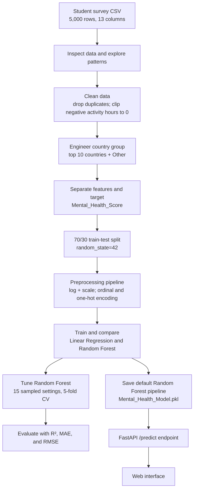

# Wellnest

Wellnest is a student mental-health score prediction project. It uses social-media habits, demographics, study and lifestyle information, and reported stress to estimate a continuous `Mental_Health_Score`. The project includes the model-training notebook, a FastAPI prediction service, and a browser-based interface.

> This is an educational prediction demo, not a medical assessment or substitute for professional care.
> Live link - [Wellnest](https://wellnest-1-xgy5.onrender.com/)

## How the model was created

The workflow below summarizes [`ML_Project.ipynb`](ML_Project.ipynb):



### Data and preparation

The notebook loads [`Student Social Media And Mental Health Impact.csv`](Student%20Social%20Media%20And%20Mental%20Health%20Impact.csv). The target is `Mental_Health_Score`; the predictors cover age, gender, country, academic level, social platform and purpose, usage hours, daily unlocks, study hours, physical activity, sleep, and stress.

The notebook checks the data and explores score distributions, correlations, stress levels, usage and sleep patterns, platform counts, outliers, and numeric skew. It removes duplicate rows and clips negative `Physical_Activity_Hours` values to zero. To limit high-cardinality country data, it keeps the ten most frequent countries as separate categories and groups the rest as `Other`.

### Preprocessing and models

The data is split into training and test sets with a 70/30 ratio and `random_state=42`. Preprocessing is kept inside a scikit-learn `ColumnTransformer` and `Pipeline` so the same transformations are applied at training and prediction time:

- `Study_Hours`: `log1p`, then standard scaling.
- Other numeric features: standard scaling.
- `Stress_Level`: ordinal encoding in the order Low, Medium, High, Very High.
- Other categorical features: one-hot encoding, ignoring unseen categories.

The notebook compares Linear Regression with a default Random Forest Regressor. It also runs a 15-iteration, 5-fold `RandomizedSearchCV` over Random Forest tree count, depth, and split/leaf size. The reported held-out test results are:

| Model | Test R² | Test MAE | Test RMSE |
|---|---:|---:|---:|
| Linear Regression | 0.7398 | 0.5362 | 0.6760 |
| Random Forest (default) | 0.8776 | 0.3472 | 0.4637 |
| Random Forest (tuned) | 0.8650 | 0.3689 | 0.4869 |

R² measures explained variation; MAE and RMSE are errors in score points (lower is better). These are the notebook's results for its recorded split and run.

**Model artifact note:** the notebook saves `rf_pipeline` to `Mental_Health_Model.pkl`, which is the default Random Forest pipeline. The tuned estimator is evaluated but is not the artifact currently saved and loaded by the API.

## Run locally

Use a Python environment with the packages listed in [`requirements.txt`](requirements.txt). The saved scikit-learn model should be loaded with a compatible scikit-learn version.

1. Install dependencies:

   ```powershell
   python -m venv .venv
   .\.venv\Scripts\Activate.ps1
   pip install -r requirements.txt
   ```

2. Start the API from the project directory:

   ```powershell
   uvicorn main:app --reload --host 127.0.0.1 --port 2200
   ```

   The prediction endpoint is `http://127.0.0.1:2200/predict`; interactive API documentation is at `http://127.0.0.1:2200/docs`.

3. In a second terminal, serve the frontend:

   ```powershell
   python -m http.server 5500
   ```

   Open `http://127.0.0.1:5500/`. The frontend sends predictions to the API URL configured in `script.js`.

## Prediction input

The `POST /predict` endpoint validates the student information and returns a predicted score rounded to two decimal places. For example:

```json
{
  "age": 21,
  "gender": "Male",
  "country": "India",
  "academic_level": "Undergraduate",
  "most_used_platform": "Instagram",
  "purpose_of_use": "Entertainment",
  "avg_daily_usage_hours": 4.5,
  "daily_unlocks": 150,
  "study_hours": 3.0,
  "physical_activity_hours": 1.5,
  "sleep_hours_per_night": 7.0,
  "stress_level": "Medium"
}
```

## Project files

- `ML_Project.ipynb` — data exploration, preprocessing, model training, comparison, and evaluation.
- `Student Social Media And Mental Health Impact.csv` — training dataset.
- `Mental_Health_Model.pkl` — serialized preprocessing and default Random Forest pipeline.
- `main.py` — FastAPI service and request validation.
- `index.html`, `style.css`, `script.js` — browser interface.
- `requirements.txt` — Python dependencies.
